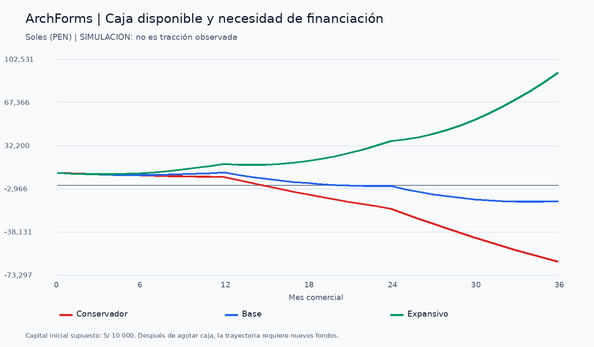
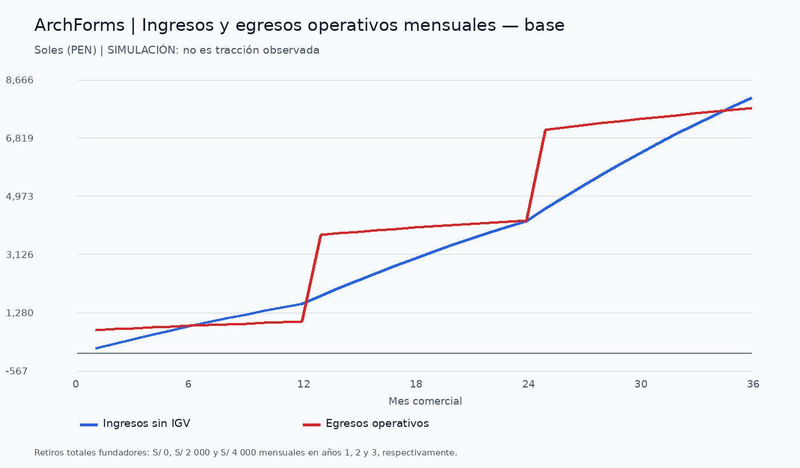

# ArchForms — Investment Memo

**Universidad de Ingeniería y Tecnología · Inversiones, Startups e Innovación**  
**Integrantes:** César Perales y Melisa Rivera  
**Lima, Perú · 20 de noviembre de 2026**

## 1. Tesis del negocio

**ArchForms integra la captura de fotografías, voz y checklists en obra con la edición y generación de informes para arquitectos inspectores y supervisores, priorizando formatos familiares y el control del criterio técnico por el profesional.**

Nuestra oportunidad inicial consiste en convertir un trabajo fragmentado entre celular o cámara, apuntes físicos y Word/Excel en un único flujo de documentación. Nuestra tesis es que un profesional con informes frecuentes estará dispuesto a pagar S/ 60 mensuales si puede entregar un documento utilizable con menos trabajo total y sin perder control sobre sus observaciones. Nuestro éxito depende de demostrar ese ahorro, la repetición de uso y el pago.

**Razones para considerar la inversión**

- **Un beneficio concreto para el profesional.** Atacamos una tarea que consume horas de trabajo repetitivo: en nuestras entrevistas, Vicky Rosales describe cuatro a cinco horas de gabinete por informe y Laura Rojas, aproximadamente tres horas solo para organizar fotografías. Buscamos liberar al menos dos horas en los casos de mayor carga documental, para que nuestros usuarios puedan dedicarlas a otras responsabilidades profesionales. Validaremos ese objetivo mediante informes comparables. [I1], [I2]
- **Una puerta de entrada a más necesidades del arquitecto.** La documentación de obra es el primer problema que abordamos. A mediano plazo, queremos aprovechar el conocimiento del usuario y la relación construida para desarrollar soluciones a otras tareas recurrentes de su práctica. Esa cercanía nos permitirá evaluar nuevas oportunidades con una base de aprendizaje compartida y diversificar nuestras fuentes de ingreso progresivamente.
- **Un equipo con cercanía al problema y capacidad para resolverlo.** Combinamos experiencia en desarrollo web y de aplicaciones con un entorno familiar de arquitectos que nos permite conocer su trabajo cotidiano, acceder a formatos reales y recibir feedback directo. Ya hemos convertido ese conocimiento en un MVP funcional con captura, edición y exportación de informes. [I4]

**Preguntas difíciles y riesgos principales**

1. **¿Por qué pagar por ArchForms frente a herramientas económicas ya disponibles?** Nuestra propuesta se apoya en una experiencia personalizada para el arquitecto: checklists adaptables, fotografías vinculadas a sus observaciones y edición dentro del mismo flujo, con formatos cercanos a los que ya utiliza. No le pedimos que adapte toda su práctica a una herramienta genérica; buscamos que pueda pasar de la visita al informe conservando su forma de trabajar y su criterio técnico. Esa continuidad y el menor trabajo de gabinete son el valor que buscamos ofrecer por S/ 60 mensuales, frente a opciones como Report and Run, cuya versión Upgraded anuncia USD 9,99 al año. [C1]
2. **¿Podemos vender y dar soporte de forma sostenible?** Sí: ambos somos desarrolladores y podemos atender directamente los problemas del producto, sin depender de un proveedor externo para cada corrección. Asumimos el compromiso de revisar los mensajes de usuarios diariamente y priorizar semanalmente el feedback, distinguiendo incidencias que bloquean el trabajo de mejoras de personalización. Complementaremos ese acompañamiento con una introducción guiada y materiales reutilizables; mediremos el tiempo de atención por cliente para mantener una experiencia cercana a medida que crezcamos.
3. **¿Cómo superaremos la curva de aprendizaje y adaptaremos el producto a otras regiones?** Partimos de formatos familiares y acompañaremos al profesional en su primer informe para facilitar la transición desde Word y Excel. Para expandirnos, conservaremos el flujo común de captura, revisión y exportación, y adaptaremos checklists y formatos con profesionales de cada mercado. Así podremos trasladar nuestra experiencia sin asumir que todos los países trabajan con los mismos requisitos.

| Datos de la oportunidad | Propuesta / estado |
|---|---|
| Capital solicitado | S/ 10 000. |
| Etapa | Pre-seed / validación comercial con MVP implementado. |
| Valoración propuesta (pre-money) | USD 450 000. |
| Instrumento | Nota convertible. |
| Sede | Lima, Perú. |

### Justificación de la valoración

## 2. Problema

El inspector o supervisor recoge información durante una visita y debe convertirla después en un informe comprensible y entregable. Cuando fotografías, notas y checklist quedan separados, el trabajo de gabinete consiste en trasladar archivos, seleccionar imágenes, recordar su contexto, acomodarlas en una plantilla y volver a redactar observaciones. El costo no es únicamente la maquetación: también hay demora y riesgo de olvidar qué documenta cada foto.

En nuestras entrevistas identificamos perfiles con necesidades diferentes:

| Caso documentado | Trabajo actual / tiempo declarado | Implicación |
|---|---|---|
| Vicky Rosales, inspectora y otros roles | Entre 30 minutos y 2 horas en campo; 4–5 horas de informe en casa; Excel para organizar fotografías. | Perfil prioritario: documentación manual y alto trabajo posterior. |
| Laura Rojas, supervisora privada | Aproximadamente 3 horas de gabinete solo para fotos; ya usa Report and Run y entrega informes en Word. | Exige demostrar valor incremental respecto de una app existente. |
| Israel, inspector y proyectista | Aproximadamente 1 hora de gabinete con formatos estandarizados. | Menor urgencia; no permite prometer un ahorro mínimo universal de dos horas. |

Estos tiempos declarados en nuestras entrevistas nos permiten priorizar a los profesionales con mayor carga de documentación. [I1], [I2], [I3].

**Economía del problema.** Como ejemplo aportado por el equipo, una visita facturada en S/ 500, con S/ 100 de movilidad y cinco horas totales de trabajo, deja S/ 400 antes de otros costos e impuestos: S/ 80 por hora. Si el mismo entregable requiere tres horas totales, ese cociente sube a S/ 133,33. El ejemplo ilustra el costo de oportunidad del tiempo; no establece honorarios promedio ni garantiza ingresos adicionales por las horas liberadas.

**Alternativas actuales.** Word y Excel permiten conservar formatos conocidos y editar libremente, aunque exigen organización manual de la evidencia. WhatsApp, Drive y la galería del celular resuelven transferencia y almacenamiento, pero no necesariamente articulan el informe. Report and Run, ArchiSnapper y otras aplicaciones sí automatizan partes relevantes del proceso: la oportunidad no proviene de la ausencia de software, sino de encontrar usuarios cuyo flujo siga insuficientemente atendido.

También identificamos a **Obsidia como competidor directo**, por abordar un flujo similar. Según nuestra evaluación inicial, su enfoque concede un protagonismo elevado a la IA en la redacción de contenido que consideramos propio del criterio del especialista; esta comparación requiere corroboración con una demostración del producto. Nuestra elección es preservar ese criterio: automatizamos la organización y facilitamos la transcripción, mientras el profesional formula, revisa y aprueba sus observaciones. La Ley 29090 sitúa la verificación técnica dentro de un marco de responsabilidad profesional; por ello, diseñamos ArchForms para apoyar al responsable del informe y mantener su control sobre el contenido. Este fundamento no implica que la ley prohíba utilizar IA para redactar. [L1]

## 3. ICP (Ideal Customer Profile)

### Perfil demográfico

Nuestro cliente inicial es un arquitecto acreditado para realizar inspecciones de obra en Perú o un arquitecto que ejerce supervisión privada, con entrada comercial en Lima. Nos dirigimos a profesionales independientes con autonomía para elegir sus herramientas de trabajo. En el perfil que planteamos a partir de nuestro acercamiento inicial destacan profesionales de alrededor de 50 años y de nivel socioeconómico medio-alto; utilizamos estos rasgos como orientación comercial, no como requisitos de acceso al producto.

### Perfil de comportamiento

Priorizamos a quienes valoran recuperar tiempo, elaboran informes recurrentes y utilizan Word, Excel y WhatsApp al menos dos veces por semana en su práctica. También buscamos familiaridad con servicios digitales de pago, como almacenamiento en Drive: es una señal de afinidad con herramientas que ofrecen comodidad, que complementaremos con una oferta concreta de ArchForms. Su principal motivación es simplificar la documentación sin perder control sobre el informe.

| Dimensión | Criterio de selección inicial |
|---|---|
| Actividad | Inspección municipal o supervisión privada con entregables compatibles con el MVP. |
| Frecuencia | Hipótesis de selección: al menos cuatro informes mensuales; registrar frecuencia real antes de asumir necesidad de suscripción. |
| Dolor | Trabajo repetido de transferencia, selección, descripción y maquetación; priorizar casos de dos o más horas de gabinete declaradas. |
| Herramientas | Celular Android, Word/Excel y canales digitales de intercambio; sin un flujo satisfactorio de captura a informe. |
| Compra | El profesional decide y paga; una eventual venta a municipalidades o constructoras tendrá otro proceso comercial. |
| Resultado buscado | Registrar la visita y entregar un informe revisado sin reconstruirlo desde cero en gabinete. |

### Segmentación

| Segmento | Atractivo / condición de entrada | Tamaño documentado |
|---|---|---|
| Arquitectos IMO de Lima | Canal inicial identificable y formatos cercanos a los estudiados. Validar quién ejerce y emite informes con frecuencia. | 86 colegiaturas distintas en la unión de dos padrones CAP con periodos superpuestos. |
| Supervisores privados arquitectos | Flujo de evidencia e informe semejante; frecuencia, comprador y formatos por validar. | No establecido con fuente oficial de actividad en esta investigación. No sumar automáticamente a quienes también figuran como IMO. |
| Ingenieros IMO | Adyacencia funcional; requiere entrevistas y plantillas por especialidad. | 130 colegiaturas en CIP Lima; 38 en la unión de padrones CIP Piura. |
| Otros consejos y países | Expansión posterior a probar retención y soporte. | Se dispone de padrones parciales; no de un censo nacional o latinoamericano del ICP. |

Segmentamos primero por actividad —inspección municipal y supervisión privada— y después por geografía: Lima, otras regiones del Perú y, a mediano plazo, Latinoamérica. Ambos perfiles comparten el trabajo de capturar evidencia y preparar informes; adaptaremos los formatos al destinatario y a las responsabilidades de cada encargo. En el marco de la Ley 29090, la participación del supervisor privado en verificación técnica está sujeta a los requisitos y condiciones aplicables. [L1]

### Casos de uso

- **Inspección municipal:** registrar evidencia durante la visita, asociar fotografías con observaciones y preparar el informe para su revisión y entrega a la municipalidad.
- **Supervisión privada:** documentar hallazgos y avances de obra, organizar las observaciones por visita y entregar un informe al cliente o responsable del proyecto.
- **Seguimiento de visitas:** consultar la documentación del expediente y mantener ordenados los registros de cada visita, sin reconstruir el contexto desde la galería del celular.

### Composición actual de clientes

Nuestra base inicial de contacto comercial comprende tres profesionales identificados por el equipo. Aún debemos consolidar su distribución por actividad, frecuencia de informes y condición de uso o pago. Nuestro conocimiento del segmento se apoya además en siete entrevistas a profesionales con roles diversos y en un piloto planteado con dos arquitectos. Reportaremos por separado contactos, participantes del piloto y suscriptores para presentar con precisión la composición de nuestra cartera. [I3], [I4]

## 4. MVP / Solución

Hemos construido ArchForms para organizar el trabajo alrededor de un expediente y sus visitas. Permitimos al profesional crear o seleccionar un expediente, utilizar un checklist, capturar fotos y notas de voz, revisar los hallazgos y editar el informe antes de exportarlo a PDF.

**Flujo de valor:** expediente → visita y checklist → fotos agrupadas con observaciones → revisión del profesional → informe editable en la app → PDF para compartir.

| Capacidad implementada | Funcionalidad |
|---|---|
| Expedientes, visitas y checklists personalizables | Organizamos los registros por expediente y conservamos una copia del checklist correspondiente a cada visita. |
| Captura de fotos y audio asociados a hallazgos | Conservamos el contexto de las observaciones junto a las imágenes en el flujo móvil. |
| Persistencia local y sincronización | Guardamos el trabajo localmente y gestionamos una cola de operaciones y medios para sincronizarlo al recuperar conexión. |
| Transcripción de notas de voz | Integramos Whisper local en Android, con descarga inicial del modelo, para convertir el dictado del profesional en texto revisable. |
| Editor y exportación PDF | Permitimos revisar textos y fotografías dentro de la aplicación y regenerar el documento antes de compartirlo. |

Nuestra propuesta de valor es evitar que el arquitecto tenga que reconstruir su documentación en gabinete. Integramos IA de forma controlada: transcribimos sus notas y dejamos en sus manos la revisión y la decisión sobre qué entregar. Diseñamos la edición dentro de la aplicación y los formatos cercanos a su práctica para reducir la necesidad de trasladar el informe a Word o Excel.

Operamos con un modelo asset-light, basado íntegramente en software. Desarrollamos el cliente con React/TypeScript y Capacitor para Android, almacenamiento local y backend Supabase. Esta estructura nos permite reutilizar el flujo y adaptar los checklists, campos y formatos a nuevas especialidades y mercados. Nuestros costos operativos se concentran en infraestructura, almacenamiento de medios, mantenimiento y soporte. [I4], [I5]

**El momento de valor que buscamos ofrecer** ocurre al terminar una visita: el arquitecto encuentra sus fotos vinculadas a las observaciones, revisa el contenido y obtiene un PDF listo para compartir. Evaluaremos nuestra meta de ahorro de dos horas con informes comparables y considerando todo el trabajo de documentación. En nuestras entrevistas, la reacción de Vicky —«Ay, sería increíble»— sintetiza el interés por reducir esa carga de gabinete. [I1]

## 5. Tamaño de Mercado

Medimos nuestro mercado en **licencias individuales** para profesionales que producen informes compatibles. Un profesional que también supervisa para privados representa una sola licencia.

**Fórmula:** profesionales únicos elegibles × precio anual por licencia. A S/ 60 mensuales, doce mensualidades equivalen a S/ 720 cobrados al año; si el precio incluye IGV, el ingreso anual sin IGV es aproximadamente S/ 610,17. [L2]

**Base oficial identificada**

| Consejo emisor | Arquitectos CAP | Ingenieros CIP | Lectura correcta |
|---|---:|---:|---|
| Lima | 86 | 130 | CAP: unión 2025–2027 y 2026–2028, depurada por colegiatura. CIP: periodo agosto 2026–julio 2027, depurado entre especialidades. |
| Piura | 32 | 38 | CAP: publicación de noviembre 2026. CIP: unión 2025–2027 y 2026–2028, descontando una revalidación repetida. |
| Arequipa | 36 | 24 | Listas 2024–2026; confirmar fecha exacta de vencimiento antes de incorporarlas al mercado vigente. |

Fuentes: [CAP Lima][M1], [CIP Lima][M3], [CAP Piura][M4], [CIP Piura][M5], [CAP Arequipa][M7] y [CIP Arequipa][M8]. Los cálculos y enlaces directos a cada padrón están en el [respaldo de investigación](soporte/Investigacion-y-criterios.md).

Los cuatro conjuntos Lima/Piura suman **286 identificaciones colegio–colegiatura**; no constituyen un censo nacional ni aseguran 286 personas únicas entre colegios. Los padrones no permiten asignar rigurosamente a cada profesional una provincia de ejercicio. Esa desagregación queda pendiente de un consolidado institucional con ámbito territorial; no se sustituye por una distribución estimada.

| Nivel | Definición aplicada a ArchForms | Dimensionamiento defendible hoy |
|---|---|---|
| **TAM** | Todos los profesionales de inspección/supervisión que generan informes compatibles en la geografía elegida. | **No cerrado.** Faltan consolidado nacional depurado y denominador de supervisores privados activos. Se retiran las cifras sin sustento de 1 000 en Perú y 100 mil en Latam. |
| **SAM inicial** | Arquitectos del padrón IMO CAP Lima a quienes se busca servir con el flujo inicial. | **Hasta 86 candidatos**, sujeto a actividad y compatibilidad. Techo teórico de S/ 61 920 cobrados/año o S/ 52 475 sin IGV, no ventas previstas. |
| **SOM experimental, 36 meses** | Licencias activas que un proceso comercial pequeño podría sostener. | **Aproximadamente 22 licencias**, según el embudo supuesto descrito abajo: S/ 15 840 anuales cobrados o S/ 13 424 sin IGV. |

El SOM se construye desde capacidad comercial: diez demostraciones cualificadas mensuales × 50% que completa un informe real × 20% de esos activados que paga = una alta mensual. Con churn supuesto de 3% mensual, `N36 = (1 − 0,97^36) / 0,03 = 22,20`. Son hipótesis experimentales; conseguir 36 altas brutas dentro de 86 candidatos exige una conversión acumulada importante y no está asegurado.

Como siguiente expansión, incluir ingenieros de Lima amplía la referencia publicada a 216 identificaciones CAP+CIP y un techo de S/ 155 520 cobrados/año, antes de comprobar doble titulación, actividad y adecuación del producto. Supervisores privados y otras regiones podrían ampliar el universo, pero todavía no tienen una cifra defendible.

**Latinoamérica.** La expansión es una opción estratégica, no un TAM cuantificado. Como contexto, la Secretaría de Economía de México publica aproximadamente 151 mil ocupados en «Arquitectos, Planificadores Urbanos y del Transporte», 2026-T1. Esa categoría no identifica inspectores ni supervisores y no puede multiplicarse íntegramente por nuestra suscripción. [M9]

**Implicación para la tesis:** el nicho municipal inicial permite validar un negocio especializado, pero su escala documentada es limitada. Para sostener una tesis venture se deberá demostrar expansión del número de clientes, ingreso por cuenta o productos adyacentes. No hay evidencia de un mercado winner-takes-all: hoy importan formatos, distribución y servicio; la resistencia al cambio no equivale a efectos de red.

## 6. Modelo de Negocio

### Ingresos y adquisición

Proponemos una suscripción individual de **S/ 60 mensuales**, con reportes ilimitados. Definiremos condiciones de almacenamiento, retención de medios y uso de servicios para mantener costos previsibles. En nuestro modelo financiero consideramos S/ 60 como precio final con IGV.

Lideraremos directamente la venta y el onboarding mediante contactos profesionales, referidos y demostraciones con un informe real. Probaremos publicidad en lotes pequeños una vez que observemos activación y repetición, midiendo conversión hasta pago y soporte requerido.

### Economía unitaria: supuestos para experimentar

| Concepto | Cálculo ilustrativo por cliente / mes |
|---|---:|
| Cobro final | S/ 60,00 |
| Ingreso sin IGV | S/ 50,85 |
| Servicio incremental supuesto: medios, operación y soporte | S/ 8,00 |
| Comisión de cobro supuesta: 3% del precio final | S/ 1,80 |
| Contribución antes de adquisición, fijos y fundadores | **S/ 41,05** |
| Margen de contribución sobre ingreso sin IGV | **80,7%** |
| CAC de caja supuesto, escenario base | S/ 100 |
| Recuperación simple de ese CAC con cliente retenido | Aproximadamente **2,44 meses** |

Estos valores no son unit economics observados ni cotizaciones contratadas. El CAC completo añadirá tiempo comercial y de onboarding; si el soporte excede lo contemplado, también subirá el costo de servicio. No se publica un LTV histórico porque todavía no hay cohortes de pago documentadas. Como sensibilidad a doce meses, con contribución constante y churn mensual de 3%, la contribución esperada de un cliente sería aproximadamente S/ 419 antes de costos fijos y comerciales completos; es una simulación, no evidencia de LTV/CAC logrado.

### Uso propuesto de S/ 10 000

| Destino | Presupuesto propuesto | Resultado a evaluar |
|---|---:|---|
| Captación experimental: demostraciones, materiales y pauta acotada | S/ 5 000 | Altas pagantes atribuibles y CAC por canal. |
| Operación de piloto e infraestructura | S/ 3 000 | Informes terminados y continuidad del servicio. |
| Reserva para soporte, correcciones y contingencias | S/ 2 000 | Resolver bloqueos sin interrumpir el piloto. |
| **Total** | **S/ 10 000** | Desembolso condicionado al aprendizaje comercial. |

Es una asignación de financiación, no un gasto inmediato adicional al flujo. El modelo registra mensualmente adquisición, costos fijos y servicio, financiados por el aporte y los cobros. El trabajo de desarrollo de los founders durante el primer año no se paga con este presupuesto: debe reconocerse como aportación de tiempo, no como costo inexistente.

### Flujo de caja a 36 meses

Construimos un [modelo reproducible en Python](soporte/modelo_financiero.py), con [supuestos editables](soporte/supuestos_financieros.json), [detalle mensual CSV](soporte/flujo_mensual_36m.csv) y [resumen anual](soporte/resumen_anual.csv). El mes 1 representa nuestro primer mes comercial completo.

**Supuestos comunes:** S/ 10 000 iniciales; cero clientes iniciales como convención de simulación; cobro mensual al inicio del mes; costos fijos de S/ 400, S/ 800 y S/ 1 200 mensuales en los tres años; retiros totales de founders de S/ 0, S/ 2 000 y S/ 4 000 mensuales, respectivamente. Se reserva el IGV de ventas sin descontar crédito fiscal. Es un flujo operativo simplificado **antes de impuesto a la renta**, costos extraordinarios y efectos de la nota convertible. Los retiros no representan remuneraciones de mercado ni costo laboral integral.

| Escenario | Altas brutas por mes, años 1 / 2 / 3 | Churn mensual supuesto | CAC de caja supuesto |
|---|---|---:|---:|
| Conservador | 1 / 3 / 5 | 5% | S/ 100 |
| Base | 3 / 6 / 10 | 3% | S/ 100 |
| Expansivo | 6 / 12 / 20 | 2% | S/ 80 |

Estas trayectorias exploran las condiciones de viabilidad; el escenario base es más exigente que el SOM experimental y necesita ampliar el segmento inicial. El expansivo rebasa también el universo parcial Lima/Piura. Ninguno se presenta como captación garantizada por los padrones.

| Escenario base | Año 1 | Año 2 | Año 3 |
|---|---:|---:|---:|
| Suscriptores al cierre, valor esperado* | 30,6 | 82,5 | 159,3 |
| Ingresos anuales sin IGV | S/ 10 683 | S/ 36 775 | S/ 77 121 |
| Flujo neto anual | S/ 224 | −S/ 11 112 | −S/ 12 143 |
| Caja al cierre, antes de financiación adicional | S/ 10 224 | −S/ 889 | −S/ 13 031 |

*El modelo aplica bajas esperadas y produce fracciones; no son conteos de personas reales.*

En el base, la caja se vuelve negativa por primera vez en el **mes 21**. El déficit máximo del horizonte es aproximadamente **S/ 13 486 adicionales** al aporte inicial. El flujo mensual se mantiene no negativo desde el mes 35 hasta el cierre simulado; eso no elimina el déficit acumulado. Las trayectorias posteriores a agotar caja requieren financiación adicional o reducir egresos.

Los saltos de egresos reflejan incorporar retiros para los fundadores y mayores costos de operación, no una caída repentina de usuarios. En el conservador, la caja se agota en el mes 15 y el déficit máximo adicional llega a unos S/ 62 501. En el expansivo permanece positiva dentro del horizonte, condicionado a alcanzar sus altas y retención.

**Lectura económica:** el año 1 del base casi equilibra caja porque no paga a los founders. Imputar S/ 2 000 mensuales de trabajo no remunerado agrega S/ 24 000 de costo económico ese año. Para cubrir los egresos del tercer año base —S/ 1 200 fijos, S/ 4 000 de retiros y S/ 1 000 de adquisición mensual— se necesitan aproximadamente **152 clientes retenidos** a la contribución supuesta, antes de renta y de otros costos excluidos. La cifra vuelve a mostrar que el padrón inicial CAP Lima no basta por sí solo.

El flujo sirve para decidir precio, presupuesto y metas, no para sostener una valoración por descuento de flujos o por múltiplo de ingresos todavía no observados.

## 7. Tracción

**Hemos avanzado en el descubrimiento del problema y construido nuestro MVP.** Nuestra siguiente prioridad es convertir ese aprendizaje en uso recurrente y suscripciones. Presentamos por separado nuestro avance de validación y los indicadores comerciales que comenzaremos a medir.

| Evidencia al corte | Qué permite afirmar | Qué falta acreditar |
|---|---|---|
| Siete resúmenes de entrevistas | Existe aprendizaje sobre diferentes perfiles y niveles de dolor. | Fechas y muestra comercial actualizadas; no equivalen a siete usuarios del producto. |
| Formatos reales analizados y flujo implementado | El MVP responde a documentos y prácticas concretas. | Aceptación de informes generados y uso en visitas reales. |
| Piloto con dos arquitectos planteado en roadmap | Hay un siguiente paso operativo definido. | Participación, fechas, informes completados y repetición. |
| Tres contactos comerciales iniciales identificados por el equipo | Contamos con una base inicial para organizar pruebas y seguimiento. | Consolidar actividad, condición gratuita/pagante y registro de cobro cuando corresponda. |
| MRR, ARR, renovaciones y retención | Aún no presentamos métricas comerciales consolidadas. | Conciliar actividad y suscripciones con registros de pago. |

El principal aprendizaje es de enfoque: el problema no afecta igual a todos los arquitectos. La entrevista a una usuaria de Report and Run muestra, además, que la solución debe superar una alternativa real. Esta evidencia refina el ICP, pero no prueba product–market fit. [I3]

**Qué constituirá tracción en la siguiente actualización**

| Indicador prioritario | Definición operativa / evidencia |
|---|---|
| Activación | Profesional que completa su primer informe de una visita real, exporta un PDF utilizable y confirma el destinatario; excluir demos y reexportaciones duplicadas. Mostrar n/N invitados y activados. |
| Repetición y retención | Segundo informe en la siguiente oportunidad de uso; además, cohorte mensual de activados que vuelve a terminar un informe. Mostrar separadamente quiénes tuvieron nueva visita y quiénes no. |
| Pago y renovación | Primer cobro real, tarifa/descuento y segunda mensualidad; MRR neto de IGV y no recurrentes, conciliado con las suscripciones vigentes. |
| Valor y esfuerzo de servicio | Tiempo total manual frente a tiempo con app, correcciones y minutos de soporte por informe / cliente. Presentar mediana y casos individuales mientras la muestra sea pequeña. |

La medición de actividad por resultado, la separación entre intención y revenue y las cohortes consistentes siguen criterios de [Y Combinator][T1] y [Stripe][T2]. La frecuencia del trabajo manda: abrir diariamente la app no es el resultado relevante para alguien que emite informes semanales.

Durante los primeros pilotos reportaremos conteos, tiempos y secuencia de casos, identificando el acompañamiento requerido y el origen de cada contacto. Así podremos seguir la transición desde el interés inicial hasta el uso independiente, el primer pago y la renovación.

## 8. Framework de Experimentos

Nuestras prioridades son validar utilidad, repetición y pago antes de escalar adquisición. Hemos definido los siguientes **criterios de decisión** para un horizonte de doce semanas desde el inicio efectivo del piloto.

| Hipótesis | Experimento / plazo | Criterio de decisión propuesto | Acción si no se cumple |
|---|---|---|---|
| El flujo reduce trabajo sin deteriorar el entregable. | Semanas 1–4: iniciar con dos profesionales y ampliar a cinco; reunir al menos diez informes comparables con línea base manual, tiempos y revisión del destinatario. | Reducción mediana ≥50% del tiempo total de documentación; documentar si además llega a dos horas. Al menos 8/10 informes utilizables sin reconstrucción externa. | Identificar formatos incompatibles y trabajo desplazado al campo; ajustar flujo o estrechar ICP. |
| La captura offline es confiable. | Semanas 1–4: al menos diez visitas / sesiones controladas con modo avión, cierre y recuperación de red, además del piloto. | Cero pérdidas irrecuperables; diez visitas recuperadas y sincronizadas sin duplicados que alteren el informe. | Priorizar estabilidad antes de ampliar captación. Un fallo basta para investigar, no para promediarlo fuera. |
| El usuario repite con poca asistencia. | Semanas 3–8: observar la segunda oportunidad real y registrar toda la ayuda. | Al menos 3/5 profesionales con nueva oportunidad terminan su segundo informe; soporte ≤15 minutos por informe después del onboarding. Mostrar también retención sobre todos los activados. | Revisar aprendizaje, confiabilidad y frecuencia; no aumentar pauta para ocultar abandono. |
| Hay disposición a pagar S/ 60. | Semanas 5–10: oferta explícita a diez profesionales cualificados, preferentemente fuera de la familia, tras una prueba breve. | Al menos tres primeros pagos a precio final comunicado y dos renovaciones cuando hayan vencido los ciclos. | Entrevistar rechazados; contrastar precio, suscripción frente a frecuencia y valor respecto de alternativas. |
| Existe un canal comercial repetible. | Semanas 8–12: comparar referidos y demostración / pauta en lotes de hasta S/ 500. | CAC completo ≤S/ 150 y recuperación esperada ≤4 meses con contribución medida. Con menos de cinco pagantes por canal, tratarlo como exploración, no validación. | Revisar segmento y canal; mantener el presupuesto restante hasta aclarar conversión. |

**Responsables:** nos organizaremos con César al frente de instrumentación técnica, recuperación de datos y calidad del informe, y Melisa coordinando reclutamiento, observación, pagos y entrevistas posteriores. Revisaremos juntos semanalmente los tiempos, bloqueos y pérdidas del embudo.

**Presupuesto de aprendizaje:** reservar hasta S/ 1 000 de la partida de captación para los dos primeros lotes de canal y hasta S/ 500 de la reserva para logística y seguimiento del piloto. No son gastos adicionales al uso de fondos de la sección 6. El tiempo de los founders se registrará, aunque no salga de caja.

**Aprendizaje ya documentado:** las entrevistas justifican reducir el alcance desde «todo arquitecto» hacia profesionales con informes frecuentes y dolor de documentación. No se presentan como experimentos ya ganados la reducción de tiempos, la retención o el precio: esas son precisamente las hipótesis pendientes.

## 9. Competencia

La competencia directa incluye aplicaciones que llevan la evidencia de campo a un informe. Las plataformas de gestión de obra son adyacentes y pueden competir directamente cuando el cliente compra sus módulos de captura o reportes. Word/Excel y el proceso conocido compiten por adopción y presupuesto.

| Alternativa | Solapamiento con ArchForms | Precio público verificable al corte | Implicación competitiva |
|---|---|---|---|
| **Report and Run** | Fotos, anotaciones, personalización y exportación PDF/DOCX. Existe evidencia de uso entre entrevistados. | Gratis: 8 reportes/mes. Upgraded: USD 9,99/año; Team: USD 10/usuario/año. | Rival directo de bajo costo. ArchForms necesita probar valor incremental, no afirmar que solo él genera informes. [C1] |
| **Report and Run Cloud** | Continuidad móvil–escritorio y colaboración. | Publica USD 9,99/mes; configuración de usuarios/imágenes no quedó verificable en el texto del selector. | La edición entre dispositivos tampoco es diferenciación exclusiva. [C2] |
| **Deltek ArchiSnapper** | Captura móvil, checklists, anotación de planos, PDF con marca y colaboración para arquitectura/ingeniería. | Tarifa actual no verificada en la página oficial consultada; no se adopta el precio de directorios. | Rival vertical con funciones amplias; «ser para arquitectos» no diferencia por sí solo. [C3] |
| **Archireport** | Observaciones, fotos, plantillas, informes automáticos y seguimiento de obra; sitio en español. | Consultar planes vigentes; no se usa una cifra sin verificar condiciones equivalentes. | Compite por el mismo flujo y puede servir a equipos con más necesidades. [C4] |
| **OBRATEC** | Dictado, transcripción, descripción de fotos por IA y redacción de informes revisables. | Publica Básico EUR 9/mes, Profesional EUR 39/mes y Enterprise EUR 399/mes. | Rival directo centrado en informes e IA. Según su documentación, captura offline y transcripción/redacción tienen condiciones distintas de conectividad. [C6] |
| **Fieldwire** | Gestión de tareas/planos y módulos de reportes y formularios. | Basic gratis; Pro USD 39/usuario/mes con pago anual; Business USD 64 bajo esa modalidad. | Adyacente integral y rival directo en ciertas tareas. El cliente puede preferirlo si necesita coordinación de equipo además del informe. [C5] |
| **Word/Excel + galería, WhatsApp y Drive** | Proceso manual flexible y conocido. | Costo incremental variable según licencias existentes. | Principal barrera de sustitución: conservar control y familiaridad sin percibir suficiente ganancia al cambiar. |
| **Obsidia** | Competidor directo identificado por nosotros por su propuesta de documentación de obra; nuestra evaluación inicial señala un mayor protagonismo de IA en la redacción. | No verificado. | Nos diferenciamos por mantener la redacción técnica bajo control del profesional. Corroboraremos el alcance de la comparación mediante una demostración y documentación del producto. |

Los precios se mantienen en su moneda y periodicidad originales para no introducir un tipo de cambio arbitrario. Las funciones son declaraciones de las páginas oficiales; no equivalen a una prueba comparativa de calidad.

**Nuestro posicionamiento:** especializamos el flujo alrededor de los documentos y prácticas de los profesionales peruanos con quienes hemos trabajado. Combinamos captura offline, voz asociada a grupos fotográficos y edición bajo control profesional. Buscamos diferenciarnos por la personalización de la experiencia y por reducir la adaptación y el retrabajo necesarios para entregar cada informe.

**Ventaja potencial y sostenibilidad.** El código y las tecnologías disponibles son replicables. Una ventaja más difícil de sustituir podría construirse con formatos realmente aceptados, onboarding eficiente, confiabilidad y referidos profesionales. Hoy no se ha demostrado un efecto de red ni una barrera tecnológica que impida la entrada de un competidor. No se utilizan valoraciones privadas sin fuente ni precios de suscripción como comparables de valoración empresarial.

## 10. Equipo

**César Perales — producto y desarrollo.** César es estudiante de décimo ciclo y cuenta con experiencia en desarrollo web y de aplicaciones. Su entorno familiar de arquitectos nos permite conocer de cerca el flujo de trabajo, acceder a documentos reales y conversar con profesionales sobre los problemas cotidianos de su práctica.

**Melisa Rivera — desarrollo y relación con clientes.** Melisa es estudiante de Ciencias de la Computación de décimo ciclo, con experiencia en desarrollo web y de aplicaciones. Dentro de nuestro equipo, lidera el contacto con usuarios, la recopilación de feedback y el seguimiento de la relación con clientes, combinando capacidad técnica con facilidad para establecer conversaciones y acompañar la adopción del producto.

Llevamos **cinco años trabajando juntos** en proyectos universitarios y personales. Hemos construido una dinámica complementaria de habilidades, opiniones y personalidades, con apertura al feedback y disposición a convertirlo en mejoras concretas. Compartimos la capacidad de desarrollar el producto y distribuimos el liderazgo entre ingeniería y relación con usuarios. Nuestro MVP es el primer resultado de esa combinación.

**Próximas capacidades a fortalecer:** adquisición comercial medible y una operación de soporte que mantenga la cercanía con el usuario al crecer. Buscaremos asesoría puntual de marketing para diseñar experimentos y atribución con entregables definidos. Para expandirnos a ingenieros, incorporaremos entrevistas y acompañamiento de profesionales de esa especialidad.

Además de cofundadores, somos pareja. Para cuidar la continuidad del proyecto, formalizaremos nuestras responsabilidades, dedicación y mecanismos de decisión, así como los acuerdos de participación, propiedad intelectual y estructura societaria necesarios para concretar la inversión.

**Nuestro compromiso:** convertir la cercanía con el problema y nuestra capacidad de desarrollo en una herramienta que el arquitecto incorpore a su práctica. Queremos construir esa relación informe a informe, con atención directa al feedback, personalización útil y una experiencia que justifique renovar la suscripción.

<!-- Referencias: el respaldo metodológico y las correcciones editoriales se encuentran en soporte/Investigacion-y-criterios.md. -->
[I1]: ../4-entrevistas-validacion/Entrevista%20-%20Vicky%20Rosales.md
[I2]: ../4-entrevistas-validacion/Entrevista%20-%20Laura%20Rojas.md
[I3]: ../4-entrevistas-validacion/Sintesis%20Cruzada%20-%20Batch%20Entrevistas.md
[I4]: ../1-entidades-y-contexto/Estado%20del%20Proyecto%20y%20Roadmap%20MVP%20ArchForms.md
[I5]: ../../../README.md
[M1]: https://limacap.org/inspectores-municipales-de-obra/
[M3]: https://cam.ciplima.org.pe/registro-unico-de-inspectores-municipales/
[M4]: https://cappiura.org.pe/2026/11/11/publicacion-oficial-cuadro-de-delegados-cap-2026-2027-y-registro-de-inspectores-municipales-de-obra-acreditados/
[M5]: https://cippiura.org/vista/asuntos_mun/
[M7]: https://www.capregionalaqp.org.pe/pages/inspector.html
[M8]: https://ciparequipa.org.pe/assets/images/comisiones/inspecmuni/Inspectoresmunicipalesdeobras2024-2026.pdf
[M9]: https://economia.gob.mx/datamexico/es/profile/occupation/arquitectos-planificadores-urbanos-y-del-transporte
[L1]: https://muniate.gob.pe/wp-content/uploads/2026/02/LEY-N%C2%B0-29090.pdf
[L2]: https://emprender.sunat.gob.pe/principales-impuestos/impuesto-general-las-ventas-igv/impuesto-general-las-ventas
[C1]: https://reportandrun.com/
[C2]: https://reportandrun.com/cloud/pricing.html
[C3]: https://www.deltek.com/products/delivery-assurance/archisnapper/
[C4]: https://archireport.com/es
[C5]: https://www.fieldwire.com/pricing/
[C6]: https://obratec.app/software-informes-obra
[T1]: https://www.ycombinator.com/blog/startup-school-week-3-recap-anu-hariharan-and-adora-cheung
[T2]: https://stripe.com/resources/more/saas-cohort-analysis
