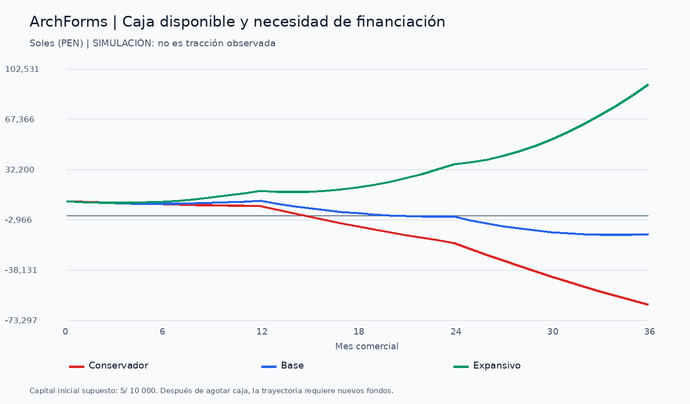

# ArchForms — Investment Memo

**Universidad de Ingeniería y Tecnología · Inversiones, Startups e Innovación**
**Integrantes:** César Perales y Melisa Rivera
**Lima, Perú · noviembre de 2026**

---

## 1. Tesis del negocio

**ArchForms es una aplicación móvil que acompaña al inspector o supervisor de obra desde la captura de fotos, notas de voz y checklists en la visita hasta el informe final en PDF, con formatos familiares para el profesional y dejando el criterio técnico en sus manos.**

Convertimos un trabajo fragmentado entre el celular, apuntes físicos, Word y Excel en un único flujo de documentación. Cobraremos S/ 60 mensuales por informes ilimitados, el mismo precio que nuestros usuarios ya pagaron por una aplicación similar que, según nos dijeron, funcionaba peor.

### Por qué ahora

Hoy podemos construir y mantener un producto de este tipo con costos bajos, y la transcripción de voz funciona dentro del propio celular. Al mismo tiempo, aparecen competidores que usan la IA para redactar el informe completo, lo que traslada al inspector un riesgo de responsabilidad profesional. Existe un espacio para una herramienta que automatice la organización sin reemplazar el criterio del profesional.

### Razones para considerar la inversión

- **Beneficio medible para el profesional.** En nuestro piloto, iniciado en noviembre de 2026, tres arquitectos generaron seis informes reales y reportan ahorros de 5 h, 2 h y 1,5 h por informe. En el primer caso, el informe manual tomaba unas 6 horas. El ahorro depende de la metodología de cada profesional, por lo que priorizamos a quienes tienen mayor carga de gabinete.
- **Negocio eficiente en capital.** Nosotros, los fundadores, somos también los desarrolladores, y no tenemos más gastos fijos que la tecnología. Con S/ 10 000 la operación no requiere financiación adicional en ninguno de nuestros tres escenarios, y el escenario base genera caja positiva desde el primer año.
- **Puerta de entrada a una suite para arquitectos.** En nuestras 40 entrevistas a 20 arquitectos identificamos otros dolores recurrentes: metrados, planos, coordinación con ingenieros, búsqueda normativa y gestión de varios proyectos en paralelo. Los informes de inspección son nuestro primer módulo. La suite ampliaría el mercado de unos 16 400 inspectores a unos 420 000 arquitectos habilitados en América Latina y el Caribe (estimación, sección 5).
- **Un equipo que vive el problema.** Toda la familia de uno de nosotros se dedica a la arquitectura: vemos de cerca el desgaste que genera el trabajo de gabinete y tenemos acceso directo a documentos reales y a profesionales del sector.

### Qué tiene que salir bien

1. Que los usuarios del piloto paguen S/ 60 y renueven al menos una vez.
2. Que logremos unas 7 altas pagantes al mes con un costo de adquisición cercano a S/ 95.
3. Que el ahorro se vea desde el primer informe, porque nuestros usuarios condicionan la renovación a notar una diferencia clara.

### Preguntas difíciles y riesgos clave

1. **¿Pagarán?** Nadie ha pagado por ArchForms todavía. En nuestras entrevistas, los arquitectos señalaron que S/ 200 mensuales les parecía excesivo; algunos ya habían pagado S/ 60 por una alternativa. Ese antecedente respalda el precio propuesto, pero aún debemos comprobar que paguen por nuestra aplicación y renueven al ver resultados claros. También importa cuántos clientes dejan de pagar cada mes: nuestro escenario base supone que se van unos 3 de cada 100. Si se fueran cerca de 5 de cada 100 (4,8 %), el valor estimado del negocio actual bajaría de S/ 85 400 a S/ 72 100; si fueran unos 6 de cada 100 (6,1 %, referencia de ChartMogul para suscripciones de menos de USD 25), bajaría a S/ 65 200. En otras palabras, necesitamos que los usuarios se queden, además de conseguir nuevos clientes (sección 6).
2. **¿Podemos sostener el negocio solo nosotros dos?** Trabajaremos sin retiros durante 18 meses y luego con retiros inferiores a un sueldo de mercado. ArchForms depende de nuestra dedicación. Además, somos pareja; lo mitigamos formalizando roles y acuerdos societarios (sección 10).
3. **¿El nicho es suficiente?** Estimamos unos 842 inspectores municipales de obra en el Perú. El negocio actual es rentable pero pequeño; escalar exige ingresar a otros países y construir la suite, que todavía no existe.

### Datos de la oportunidad

| Concepto | Propuesta |
|---|---|
| Capital solicitado | **S/ 10 000** |
| Uso de fondos | S/ 8 000 en marketing y captación; S/ 2 000 de caja chica para gastos fijos iniciales |
| Ronda | Pre-seed: MVP implementado y piloto en curso |
| Instrumento | **Nota convertible**, emitida por la S.A.C. que constituiremos antes del cierre |
| Tope de valoración | **S/ 250 000 post-money**, negociable hasta S/ 200 000 |
| Participación esperada | **4 %** del capital (4,2 % con intereses capitalizados a 24 meses); hasta 5 % si el tope baja a S/ 200 000 |
| Descuento | 20 % sobre el precio de la siguiente ronda |
| Interés | 3 % anual, capitalizable a la conversión |
| Conversión | En la primera ronda de inversión posterior al cierre; si no la hay en 24 meses, al tope de valoración |
| Sede | Lima, Perú |
| Equipo del inversor (deal team) | No aplica: buscamos un único inversionista para esta ronda |

### Valoración en resumen

Nuestro negocio actual (la aplicación de informes) vale **≈ S/ 85 400 post-money**, calculado por el enfoque de ingresos que se aplica a negocios pequeños de software. Le sumamos el potencial de la suite con un método de escenarios. Con un tope de **S/ 250 000**, asignamos a la suite una probabilidad de éxito de 4,5 %, cerca de 1 en 22. El cálculo completo está en la sección 6.

---

## 2. Problema

El inspector o supervisor recoge información durante una visita y después debe convertirla en un informe comprensible y entregable. Cuando las fotografías, las notas y el checklist quedan separados, el trabajo de gabinete consiste en trasladar archivos, seleccionar imágenes, recordar su contexto, acomodarlas en una plantilla y volver a redactar observaciones. El costo no es solo la maquetación: también hay demora y riesgo de olvidar qué documenta cada foto.

En nuestras 40 entrevistas a 20 arquitectos, en las que conversamos más de una vez con varios de ellos, identificamos perfiles con necesidades distintas:

| Caso documentado | Trabajo actual y tiempo declarado | Implicación |
|---|---|---|
| Vicky Rosales, inspectora (madre de uno de nosotros) | De 30 min a 2 h en campo; 4–5 h de informe en casa; Excel para organizar fotos | Perfil prioritario: documentación manual y alto trabajo posterior |
| Laura Rojas, supervisora privada | ~3 h de gabinete solo para fotos; usa Report and Run y entrega en Word | Debemos demostrar valor frente a una aplicación existente |
| Israel, inspector y proyectista | ~1 h de gabinete con formatos estandarizados | Menor urgencia: el ahorro no es universal |

**Economía del problema.** Como ejemplo, una visita facturada en S/ 500, con S/ 100 de movilidad y cinco horas totales de trabajo, deja S/ 80 por hora. Si el mismo entregable requiere tres horas, el valor sube a S/ 133 por hora. El ejemplo ilustra el costo de oportunidad del tiempo; no representa honorarios promedio.

**¿Es imprescindible?** Para el perfil de alta carga de gabinete, sí: es trabajo que ocurre en cada visita y que hoy se resuelve a mano. Para profesionales con formatos ya estandarizados, como Israel, es una mejora deseable pero no urgente. Por eso nuestro ICP se concentra en el primer perfil.

**Alternativas actuales.** Word y Excel conservan formatos conocidos, pero exigen organizar la evidencia a mano. WhatsApp, Drive y la galería resuelven la transferencia, pero no arman el informe. Aplicaciones como Report and Run, Obsiva u OBRATEC automatizan partes del proceso. La oportunidad no está en la ausencia de software, sino en especializar el flujo en los formatos de los inspectores peruanos y en mantener el control del profesional sobre lo que se entrega.

**Responsabilidad profesional.** El TUO de la Ley 29090 asigna la verificación técnica a los inspectores municipales de obra, arquitectos o ingenieros colegiados, hábiles y acreditados en el CAP o el CIP, y la hace obligatoria en todas las licencias (art. 10, numeral 6). Además, establece que las responsabilidades de los profesionales pueden ser administrativas, civiles o penales (art. 5) [L1]. Su reglamento dispone que el inspector comunique los hallazgos de cada visita a través del informe (art. 16.2) [L2]. El informe refleja el criterio del inspector, quien responde por él. Una herramienta que redacta el informe completo con IA, sin ese criterio, expone al profesional a un riesgo. ArchForms organiza la evidencia y transcribe el dictado; el profesional formula, revisa y aprueba cada observación.

---

## 3. ICP (Ideal Customer Profile)

### Perfil demográfico

Nuestro cliente inicial es un **arquitecto o ingeniero acreditado como inspector municipal de obra (IMO) en el Perú**, o un supervisor privado de obra, con entrada comercial en Lima. Se trata de profesionales independientes con autonomía para elegir sus herramientas. En nuestras entrevistas y en el piloto observamos profesionales de **entre 35 y 60 años**, con capacidad de pago por servicios digitales. Según el CAP, cerca del 31 % de sus agremiados supera los 45 años [P4].

### Perfil de comportamiento

- **Pagan por comodidad:** ya pagan almacenamiento en Drive o Dropbox, y algunos pagaron S/ 60 mensuales por una aplicación de informes.
- **Adoptan con cautela:** en su mayoría no son primeros adoptantes; incorporan una herramienta cuando ven resultados claros y la abandonan si no cumple. Es coherente con su entorno: la construcción es uno de los sectores menos digitalizados de la economía [A1], y en el Perú solo el 51,2 % de las personas de 60 años o más usa internet [A2].
- **Comunidad cerrada:** confían en sus pares y en la recomendación profesional, de modo que los referidos pesan más que la publicidad.
- **Valoran su criterio:** prefieren herramientas que los asistan sin reemplazar su juicio técnico.
- **Herramientas actuales:** Word, Excel y WhatsApp, que usan varias veces por semana.

| Dimensión | Criterio de selección |
|---|---|
| Actividad | Inspección municipal o supervisión privada con informes recurrentes |
| Dolor | Dos o más horas de gabinete por informe |
| Herramientas | Celular Android, Word y Excel, canales digitales; sin un flujo satisfactorio de captura a informe |
| Compra | El profesional decide y paga |
| Resultado buscado | Entregar un informe revisado sin reconstruirlo desde cero |

### A quién no nos dirigimos por ahora

- Profesionales que ya tienen formatos estandarizados y poco trabajo de gabinete (como Israel).
- Proyectistas con equipos propios que ya resolvieron sus informes con IA.
- Usuarios satisfechos con Report and Run que no perciben un problema pendiente.

### Segmentación

1. **Por actividad:** inspección municipal (prioridad) y supervisión privada.
2. **Por geografía:** Lima, luego el resto del Perú y después América Latina.
3. **Por profesión:** arquitectos primero (154 contados en tres regiones) e ingenieros después (192 contados), porque los ingenieros requieren validar plantillas por especialidad.

### Casos de uso

- **Inspección municipal:** registrar evidencia durante la visita y preparar el informe para la municipalidad.
- **Supervisión privada:** documentar avances y hallazgos, y entregar un informe al cliente.
- **Seguimiento de expedientes:** consultar visitas anteriores sin reconstruir el contexto desde la galería del celular.

### Composición actual

Hoy usan ArchForms tres arquitectos del piloto (una de ellas, madre de uno de nosotros), que ya generaron seis informes reales, y doce testers que no necesariamente son arquitectos. Contamos además con ocho contactos directos de arquitectos para ampliar el piloto. Este ICP sigue siendo una hipótesis que validaremos con el primer pago.

---

## 4. MVP / Solución

ArchForms organiza el trabajo alrededor de un expediente y sus visitas.

**Flujo de valor:** expediente → visita y checklist → fotos agrupadas con observaciones de voz → revisión del profesional → informe editable en la aplicación → PDF para compartir.

| Capacidad implementada hoy | Funcionalidad |
|---|---|
| Expedientes, visitas y checklists personalizables | Cada visita conserva su propia copia del checklist |
| Captura de fotos y audio asociados a hallazgos | El contexto de cada observación queda junto a sus imágenes |
| Trabajo sin conexión | La información se guarda en el celular y se sincroniza al recuperar la señal |
| Transcripción de voz en el dispositivo | El dictado se convierte en texto revisable sin enviar audio a terceros |
| Editor y exportación a PDF | Se revisan textos y fotos, y se regenera el documento antes de compartirlo |

| Previsto en el plan | Desde |
|---|---|
| Versión para iOS | Mes 3 |
| Almacenamiento adicional de pago | Tras el primer semestre de operación |
| Nuevos módulos de la suite (por ejemplo, búsqueda normativa) | Después de validar el pago |

**Propuesta de valor.** Evitamos que el arquitecto reconstruya su documentación en gabinete. Integramos la IA de forma controlada: transcribimos, y el profesional decide qué se entrega. La edición dentro de la aplicación y los formatos familiares eliminan el paso por Word o Excel. En el caso con mayor carga, el informe pasó de unas seis horas a cerca de una.

**Tecnología y operación.** Somos un negocio de software, sin activos físicos: React y TypeScript, Capacitor para Android (iOS desde el mes 3) y un backend en Supabase. Construimos el MVP en 48–65 horas con asistentes de IA (Claude y GPT), y esa velocidad nos permite incorporar la retroalimentación del piloto en días.

**Política de datos.** Para mantener fijo el costo de almacenamiento, conservamos los medios de cada usuario por un periodo definido, comprimimos las imágenes (el formato WebP reduce el peso entre 25 % y 34 % frente a JPEG con igual calidad [T1]) y realizamos un borrado semestral con aviso previo. Quien desee mayor retención podrá contratar almacenamiento adicional, que además será una fuente de ingreso complementaria.

**Momento de valor.** Al terminar la visita, el arquitecto encuentra sus fotos vinculadas a sus observaciones, revisa el contenido y obtiene un PDF listo. Al conocer la idea, Vicky, arquitecta de nuestra familia, respondió: «Ay, sería increíble».

---

## 5. Tamaño de Mercado

Medimos el mercado en **licencias individuales**: un profesional equivale a una licencia. A S/ 60 mensuales, el ingreso anual por licencia es S/ 610 sin IGV.

### Base contada

Contamos los padrones oficiales de inspectores IMO de tres regiones y eliminamos duplicados por número de colegiatura [M1–M6]:

| Región | Arquitectos (CAP) | Ingenieros (CIP) | Total | Población | IMO por millón de habitantes |
|---|---:|---:|---:|---:|---:|
| Lima (Lima Metropolitana) | 86 | 130 | 216 | 10,1 M | 21,4 |
| Piura | 32 | 38 | 70 | 2,12 M | 33,1 |
| Arequipa | 36 | 24 | 60 | 1,81 M | 33,1 |
| **Total** | **154** | **192** | **346** | **14,0 M** | **24,7** |

Las poblaciones provienen del INEI (Censo 2025) [P1]. Los padrones de Arequipa corresponden al periodo 2024–2026, con vigencia por confirmar.

### Estimación por regla de tres

- **Perú:** 346 × 34,16 M habitantes ÷ 14,03 M = **842 inspectores** (estimación).
- **América Latina y el Caribe:** 842 × 663 M habitantes (CEPAL, 2024) ÷ 34,16 M = **16 351 inspectores** (estimación) [P2].
- Como cota alta para el Perú, usando municipalidades en lugar de población: 346 × 1 874 municipalidades ÷ 345 = 1 879 [P3].

| Nivel | Definición | Licencias | Ingreso anual máximo (sin IGV) |
|---|---|---:|---:|
| **TAM** | Inspectores IMO y roles equivalentes en América Latina y el Caribe | 16 351 | S/ 10,0 M (USD 2,7 M) |
| **SAM** | Inspectores IMO en todo el Perú | 842 | S/ 514 000 (USD 137 000) |
| **SOM** | Clientes activos al año 3, escenario base | 155 | S/ 94 800 (USD 25 300) |

El SOM representa el **18 % del Perú** y menos del **1 % de América Latina**. Para lograrlo necesitamos 7 altas mensuales; en 36 meses serían 252 altas brutas, el 30 % del mercado peruano, porque parte de los clientes se dará de baja. Ese ritmo exige vender a arquitectos e ingenieros en todo el país, no solo en Lima.

### Visión de suite

Si la suite abarca otros problemas del arquitecto, el mercado deja de limitarse a los inspectores. El Perú tiene 21 776 arquitectos habilitados para ejercer, de 34 481 agremiados al CAP a septiembre de 2025 [P4]; por regla de tres, América Latina y el Caribe tendrían unos 422 700. Al mismo precio, el potencial superaría los USD 68 millones anuales.

### Limitaciones de la estimación

- Para Lima usamos solo Lima Metropolitana, porque no encontramos la población oficial de Lima Provincias; esto sobrestima levemente la tasa.
- La cota por municipalidades usa todos los distritos de los tres departamentos, mientras que la población de Lima es solo metropolitana.
- La figura de IMO es peruana; en otros países el rol equivalente tiene otra regulación, por lo que la cifra regional es un orden de magnitud.
- No incluimos a los supervisores privados sin padrón.

---

## 6. Modelo de Negocio

### Ingresos

Suscripción individual de **S/ 60 mensuales con IGV incluido**, con informes ilimitados, más almacenamiento adicional opcional. Cobraremos por una pasarela de pagos web, como Culqi, que cobra 3,44 % más IGV en tarjetas nacionales [S6]. Evitaremos el cobro dentro de Google Play, que retiene el 15 % de las suscripciones [S7].

### Adquisición

Venta directa con demostraciones sobre un informe real del arquitecto, referidos dentro de la comunidad profesional y pauta digital en lotes pequeños para medir cada canal. Destinamos **S/ 8 000 a marketing**, nuestra mayor debilidad y la razón principal de esta ronda. Desde el segundo año financiaremos la captación con los ingresos.

### Economía unitaria (supuestos)

| Concepto | Por cliente al mes |
|---|---:|
| Cobro final | S/ 60,00 |
| Ingreso sin IGV | S/ 50,85 |
| Comisión de la pasarela (3,44 % + IGV ≈ 4 %) | S/ 2,40 |
| **Contribución variable** | **S/ 48,45 (95 %)** |

| Indicador | Pesimista | Base | Expansivo | Referencia de la guía (SaaS Latam) |
|---|---:|---:|---:|---|
| Churn mensual | 5 % | 3 % | 2 % | Mediana 3 %; planes < USD 50: 4,8 % |
| CAC (S/ 8 000 ÷ altas del año 1) | S/ 133 | S/ 95 | S/ 67 | — |
| LTV (contribución ÷ churn) | S/ 969 | S/ 1 615 | S/ 2 423 | — |
| LTV/CAC | 7x | 17x | 36x | Mediana 9x; decil superior 15x |
| Recuperación del CAC | 2,7 meses | 2,0 meses | 1,4 meses | Mediana 14 meses; decil superior 1,6 |

Los benchmarks provienen de la guía del curso [G1]. Nuestro CAC es de marketing, derivado del presupuesto: no incluye el tiempo que nosotros dedicaremos a vender, por lo que el CAC total será mayor. Lo validaremos en el experimento de canales (sección 8). Nuestro precio equivale a unos USD 16 al mes. Para ese rango, la guía reporta 4,8 % de churn en planes de menos de USD 50, y ChartMogul, una mediana de 6,1 % en suscripciones de menos de USD 25 [G2]. Por eso consideramos exigente nuestro escenario base e incluimos ambas sensibilidades más abajo.

### Costos operativos

| Concepto | Monto | Desde |
|---|---|---|
| Supabase: plan gratuito hasta 10 clientes (se pausa tras una semana sin uso), luego plan Pro con 100 GB de archivos y 250 GB de transferencia [S1] | USD 25/mes | Mes 1–3, según el escenario |
| Hosting web: plan Pro de Vercel o Netlify [S8] | USD 20/mes | Mes 4 |
| API de traducción, prevista para la expansión regional [S2] | USD 20 por millón de caracteres; 500 000 gratis al mes | Mes 1 |
| Google Play: pago único; la publicación exige una prueba cerrada con 12 testers durante 14 días, que ya tenemos [S3] | USD 25 | Mes 1 |
| Apple Developer (iOS) [S4] | USD 99/año | Mes 3 |
| Dominio .pe [S5] | S/ 110/año | Mes 4 |

No tenemos otros gastos fijos: no hay oficina ni planilla, y nosotros somos el equipo de desarrollo. Con la compresión de imágenes y el borrado semestral, el almacenamiento máximo proyectado es de 30 GB en el escenario pesimista, 56 GB en el base y 93 GB en el expansivo, siempre dentro de los 100 GB del plan Pro. El costo de Supabase se mantiene fijo; la traducción sí crece con los usuarios, hasta unos S/ 195 mensuales en el escenario base al año 3.

### Nuestra remuneración como fundadores

No contrataremos desarrolladores. Durante los **primeros 18 meses no retiraremos dinero**. A partir del mes 19 retiraremos el excedente operativo, con un tope de S/ 2 000 mensuales entre los dos en el año 2 y de S/ 4 000 en el año 3. Valorando nuestro trabajo en S/ 2 000 mensuales, esos 18 meses representan un aporte no remunerado de S/ 36 000.

### Uso de los S/ 10 000

| Destino | Monto | Qué mediremos |
|---|---:|---|
| Marketing y captación: demostraciones, materiales y pauta | S/ 8 000 | Altas pagantes y CAC por canal |
| Caja chica: gastos fijos iniciales | S/ 2 000 | Continuidad del servicio |
| **Total** | **S/ 10 000** | |

### Escenarios

| Escenario | Altas por mes | Churn mensual | CAC |
|---|---:|---:|---:|
| Pesimista | 5 | 5 % | S/ 133 |
| **Base** | **7** | **3 %** | **S/ 95** |
| Expansivo | 10 | 2 % | S/ 67 |

El mes 1 del modelo es el primer mes comercial completo, posterior al piloto.

### Flujo de caja a 36 meses

Construimos un modelo reproducible en Python con supuestos editables [F1].

| Escenario base | Año 1 | Año 2 | Año 3 |
|---|---:|---:|---:|
| Clientes al cierre* | 71 | 121 | 155 |
| Ingresos sin IGV | S/ 24 926 | S/ 60 883 | S/ 85 832 |
| Inversión en captación | S/ 8 000 | S/ 8 000 | S/ 8 000 |
| Nuestros retiros | S/ 0 | S/ 12 000 | S/ 48 000 |
| Flujo neto | S/ 13 132 | S/ 34 157 | S/ 21 192 |
| Caja al cierre | S/ 23 132 | S/ 57 289 | S/ 78 482 |

*Valores esperados con churn; pueden ser fraccionarios.

| Escenario | Caja mínima | Financiación adicional | Clientes al año 3 | Caja al año 3 |
|---|---:|---:|---:|---:|
| Pesimista | S/ 8 800 (mes 4) | S/ 0 | 84 | S/ 27 643 |
| Base | S/ 9 342 (mes 3) | S/ 0 | 155 | S/ 78 482 |
| Expansivo | S/ 9 630 (mes 1) | S/ 0 | 258 | S/ 170 572 |

**Lectura.** Los S/ 10 000 bastan en los tres escenarios. El primer año genera caja porque no retiramos dinero. El modelo es simplificado: no incluye el impuesto a la renta ni costos extraordinarios.

**Sensibilidad al churn (escenario base).**

| Churn mensual | Clientes al año 3 | Valor del negocio actual (post-money) |
|---:|---:|---:|
| 3 % (nuestro supuesto; mediana SaaS Latam) | 155 | S/ 85 400 |
| 4,8 % (planes de menos de USD 50) | 121 | S/ 72 100 |
| 6,1 % (mediana ChartMogul, menos de USD 25) | 103 | S/ 65 200 |

En los tres casos la caja se mantiene positiva y el tope propuesto de S/ 250 000 sigue por encima del valor del negocio actual.

### Valoración

**Nivel 1: el negocio actual (informes de inspección).** Aplicamos el enfoque de ingresos que se usa para negocios pequeños:

1. Utilidad del dueño (SDE) al año 3, según nuestro modelo: S/ 34 309 en el escenario pesimista, S/ 69 192 en el base y S/ 119 148 en el expansivo.
2. Valor al año 3 = SDE × múltiplo de negocios pequeños de software, entre 2,99x y 3,41x. El rango rodea la mediana de 3,12x que BizBuySell reporta para negocios de software, aplicaciones y SaaS vendidos entre 2021 y 2025 (rango intercuartil de 2,38x a 4,00x) [V1]. No usamos el 2,0x que IBBA reporta para negocios de menos de USD 500 000 [V6], porque el mercado latinoamericano permite seguir creciendo después del año 3.
3. Sumamos la caja del año 3 y descontamos a hoy con la tasa que exige el capital de riesgo en etapa inicial: entre 50 % y 70 % anual para la etapa start-up, según Damodaran [V2]. Esa tasa ya incorpora el riesgo de fracaso, y es conservadora: el propio Damodaran muestra que el capital de riesgo temprano obtuvo en la práctica un 21,4 % anual durante 20 años.
4. Ponderamos los escenarios: 10 % pesimista, 70 % base y 20 % expansivo.

**Resultado del nivel 1: post-money ≈ S/ 85 400 (USD 22 800); pre-money ≈ S/ 75 400.**

No usamos los métodos Berkus ni Scorecard para este nivel: Berkus los diseñó para empresas que puedan facturar USD 20 millones al año 5 [V3], y aun captando a todos los inspectores de la región el producto actual facturaría unos USD 2,7 millones al año. El costo de reconstruir el software es bajo, entre S/ 600 y S/ 1 830 (65 horas a la tarifa de un desarrollador junior en Lima [V5]), lo que confirma que el valor está en el conocimiento del usuario y en la cartera, no en el código.

**Nivel 2: la suite para arquitectos.** Con la suite, el mercado potencial supera los USD 68 millones anuales (sección 5), y ArchForms pasa a ser una startup. Como referencia local de una startup pre-ingreso seleccionada, usamos lo que invierte UTEC Ventures. Las fuentes difieren: Crunchbase reporta USD 25 000 por cerca de 2,5 %, es decir ≈ USD 1 millón post-money [V4], mientras que la presentación oficial del programa (2022–2024) describe una nota convertible de USD 25 000 por 1,4 % con un tope de USD 1,8 millones [V7]. Usamos la cifra más conservadora, USD 1 millón (S/ 3,75 millones); con la del programa, la probabilidad implícita en nuestra propuesta bajaría a 2,5 %.

**Combinación por escenarios (método First Chicago):**

> Valor = (1 − p) × S/ 85 400 + p × S/ 3 750 000

donde *p* es la probabilidad de que la suite alcance ese nivel.

| Probabilidad de la suite (p) | Post-money | Participación por S/ 10 000 |
|---:|---:|---:|
| 0 % (solo el negocio actual) | S/ 85 400 | 11,7 % |
| 3,1 % | S/ 200 000 | 5 % |
| **4,5 %** | **S/ 250 000** | **4 %** |
| 11,3 % | S/ 500 000 | 2 % |

**Proponemos un tope de S/ 250 000 post-money (4 %)**, que equivale a asignar a la suite una probabilidad cercana a 1 en 22. Lo sostenemos con los dolores documentados en 40 entrevistas, un primer módulo funcionando y un piloto activo. Estaríamos dispuestos a negociar hasta S/ 200 000 (5 %). Para justificar un tope más alto, y por tanto una participación menor para el inversionista, necesitaríamos clientes pagando o un segundo módulo construido.

---

## 7. Tracción

**Validamos el problema, construimos el MVP e iniciamos un piloto. Nuestra siguiente prioridad es convertir el uso en pagos.**

| Evidencia al 20/11/2026 | Qué permite afirmar | Qué nos falta |
|---|---|---|
| **40 entrevistas a 20 arquitectos**, con conversaciones repetidas con varios de ellos | Conocemos los perfiles y el nivel de dolor de cada uno | — |
| **Piloto activo** desde inicios de noviembre de 2026 con **3 arquitectos**, que generaron **6 informes reales** (2 cada uno) | Uso real y repetido en visitas | Sostener el uso en los próximos meses |
| **Ahorros de 5 h, 2 h y 1,5 h** por informe. En el primer caso, el informe manual tomaba ~6 h y la estimación fue conservadora | El ahorro existe, pero varía según el profesional | Medición con informes comparables |
| **12 testers** que usan la aplicación gratis y nos reportan errores | El producto se estabiliza y mejora | No necesariamente son clientes potenciales |
| **8 contactos directos** de arquitectos | Base para ampliar el piloto | Convertirlos en usuarios activos |
| Historial de pago de **S/ 60/mes** por una aplicación similar que funcionaba peor | El segmento acepta pagar ese monto | El primer pago a ArchForms |
| Rechazo explícito a **S/ 200/mes** | El precio aceptable está por debajo de S/ 200 | Precisar el rango entre S/ 60 y S/ 200 |
| Ingresos recurrentes (MRR) | **S/ 0**: nadie ha pagado todavía | Primer cobro y renovación |

**Transparencia.** Vicky Rosales, la arquitecta que reporta el mayor ahorro (5 h) y a quien citamos en este memo, es madre de uno de nosotros, y César Andrés Perales, uno de los entrevistados, es su padre. Reportaremos sus resultados por separado y priorizaremos usuarios fuera de nuestra familia en las siguientes etapas. Hoy todo el uso es gratuito.

**Aprendizajes.** El dolor no es igual para todos: depende de la metodología de cada arquitecto. Nuestros usuarios pagarían, pero renovarían solo si notan una diferencia clara, de modo que la retención dependerá de que el ahorro se vea desde el primer informe.

**Indicadores que reportaremos**

| Indicador | Definición |
|---|---|
| Activación | Primer informe de una visita real exportado y entregado |
| Repetición | Segundo informe en la siguiente oportunidad de uso |
| Pago | Primer cobro de S/ 60 y segunda mensualidad |
| Valor | Horas con la aplicación frente a horas a mano, por profesional |
| Uso | Informes generados por semana y usuarios activos |

---

## 8. Framework de Experimentos

### Experimentos realizados

| Hipótesis | Experimento | Resultado | Decisión |
|---|---|---|---|
| Los arquitectos tienen un dolor de documentación que vale la pena resolver | 40 entrevistas a 20 arquitectos | Validado para perfiles con alta carga de gabinete; no para quienes ya estandarizaron sus formatos | Estrechamos el ICP a inspectores con 2 o más horas de gabinete |
| ¿Cuál problema atacar primero? | Matriz de priorización de problemas | La búsqueda normativa (38 puntos) y la redacción de informes (35) puntuaron más alto | Empezamos por la documentación de la visita; la búsqueda normativa queda como módulo candidato de la suite |
| Pagarían S/ 200 mensuales | Conversación de precio con usuarios | Rechazado; ya pagaron S/ 60 por una alternativa | Fijamos el precio en S/ 60 |
| El flujo de captura a informe ahorra tiempo | Piloto con 3 arquitectos y 6 informes reales (noviembre de 2026) | Ahorros de 1,5 h a 5 h por informe; los tres repitieron el uso | Ampliar el piloto y medir con informes comparables |

### Experimentos planificados (doce semanas desde noviembre de 2026)

| Hipótesis | Experimento y plazo | Costo | Criterio de éxito | Si no se cumple |
|---|---|---:|---|---|
| El flujo reduce trabajo sin deteriorar el informe | Semanas 1–4: ampliar de 3 a 8 arquitectos y reunir 10 informes comparables | S/ 0 | Reducción mediana ≥ 50 % del tiempo; 8 de 10 informes utilizables sin pasar por Word | Ajustar formatos o estrechar el ICP |
| La captura sin conexión es confiable | Semanas 1–4: 10 visitas con modo avión y reconexión | S/ 0 | Cero pérdidas de datos | Priorizar estabilidad antes de captar |
| El usuario repite con poca ayuda | Semanas 3–8: observar el segundo informe | S/ 0 | Al menos 5 de los 8 terminan su segundo informe; soporte ≤ 15 min por informe | Revisar la incorporación de usuarios |
| Pagarán S/ 60 | Semanas 5–10: oferta a 10 profesionales, preferentemente fuera de nuestra familia | S/ 0 | Al menos 3 pagos y 2 renovaciones | Entrevistar a quienes rechacen y revisar el precio |
| Existe un canal repetible | Semanas 8–12: referidos frente a pauta, en lotes de S/ 500 | S/ 1 000 | CAC ≤ S/ 133 (nivel del escenario pesimista) | Cambiar de canal antes de gastar el presupuesto |
| Lograremos 7 altas mensuales | Desde el lanzamiento comercial | Presupuesto de marketing | ≥ 7 altas pagantes por mes durante tres meses seguidos | Recalcular con el escenario pesimista |

**Responsables.** Nos repartimos el trabajo según nuestras fortalezas: César se encarga de la instrumentación técnica, la estabilidad y la calidad del informe; Melisa, del reclutamiento, la observación del uso, los cobros y las entrevistas. Revisamos juntos los resultados cada semana.

---

## 9. Competencia

| Alternativa | Solapamiento | Precio público | Implicación |
|---|---|---|---|
| **Obsiva** | Aplicación de informes de inspección; la IA redacta el resumen ejecutivo y las observaciones; funciona sin conexión [C7] | Gratis hasta 3 informes al mes; plan Pro sin precio público [C7] | Competidor directo, con más de mil descargas en Google Play [C8]. En nuestra prueba la encontramos poco especializada y de calidad irregular. Su IA redacta lo que corresponde al criterio del profesional |
| **Report and Run** | Fotos, anotaciones y exportación a PDF/DOCX; la usa una de nuestras entrevistadas | Gratis; mejora premium de pago único de USD 9,99 [C1] | Rival de bajo costo: debemos demostrar valor adicional |
| **OBRATEC** | Dictado, transcripción e IA para redactar informes | EUR 9 (5 informes), 39 (20 informes) y 399 al mes [C6] | Rival directo centrado en IA, desarrollado en España [C9] |
| **Deltek ArchiSnapper** | Captura móvil, checklists, planos y PDF con marca [C3] | Por cotización | Rival vertical amplio |
| **Archireport** | Observaciones, fotos, plantillas e informes automáticos [C4] | Desde USD 39 al mes, según Capterra [C10] | Compite por el mismo flujo |
| **Fieldwire** | Gestión de obra con módulos de reportes [C5] | Gratis; USD 39–64 por usuario al mes | Adyacente, orientado a equipos |
| **Word y Excel con WhatsApp y Drive** | Proceso manual y flexible | Variable | Principal barrera: la costumbre |

### Posicionamiento

| | Herramienta genérica | Especializada en inspección peruana |
|---|---|---|
| **La IA redacta el criterio** | Asistentes de IA de uso general | Obsiva, OBRATEC (sin especialización peruana) |
| **El profesional mantiene el criterio** | Word y Excel, Report and Run, Fieldwire | **ArchForms** |

Nos especializamos en los formatos y prácticas de los inspectores peruanos, con captura sin conexión, voz asociada a grupos de fotos y edición bajo control del profesional. Frente a Obsiva u OBRATEC, no generamos el criterio técnico: lo organizamos. Eso protege al inspector frente a su responsabilidad profesional y responde a lo que valora nuestro ICP: conservar su criterio.

### Sostenibilidad de la ventaja

El código es replicable: lo construimos en menos de 65 horas. Nuestra ventaja defendible está en otras cuatro cosas:
- Los formatos que aceptan las municipalidades.
- La confianza de una comunidad cerrada que funciona por recomendación.
- La confiabilidad sin conexión.
- A mediano plazo, la suite: un usuario con su historial de expedientes y varios módulos tiene más razones para quedarse.

---

## 10. Equipo

Somos César Perales y Melisa Rivera, estudiantes de décimo ciclo de UTEC. Somos los fundadores de ArchForms y también su equipo de desarrollo, y participamos en el programa de preincubación Pre-IncUVa 2026 de UTEC Ventures.

### Por qué nos importa este problema

ArchForms no nació de un análisis de mercado, sino de lo que vemos en casa. Toda la familia de uno de nosotros (César) se dedica a la arquitectura, y convivimos con el problema a diario: hemos visto a una arquitecta de la familia dedicar unas seis horas a un solo informe de inspección, ordenando fotografías, recordando qué documentaba cada una y redactando observaciones después de una jornada en obra. No necesitamos imaginar el dolor de nuestro cliente: lo vemos de cerca y sabemos lo que significa para alguien recuperar esas horas. Esa cercanía nos da acceso a documentos reales, a profesionales dispuestos a probar el producto y a una comunidad que, por ser cerrada, solo se abre a quien conoce.

### Quiénes somos

**César Perales — producto y arquitectura de software.** Me concentro en construir. Soy de perfil reservado y analítico, y mi fortaleza es diseñar y desarrollar software con rapidez: construí la primera versión de ArchForms en menos de 65 horas apoyándome en asistentes de IA. Esa capacidad nos permite resolver los problemas técnicos sin depender de terceros y mantener los costos bajos. Por ejemplo, diseñamos la compresión de imágenes y la política de almacenamiento para que el costo de infraestructura se mantenga fijo aunque crezca el número de usuarios.

**Melisa Rivera — desarrollo y relación con usuarios.** Estudio Ciencias de la Computación y desarrollo junto a César, pero mi rol principal es la relación con nuestros usuarios. Tengo facilidad para generar confianza y conversar con profesionales poco habituados a la tecnología, que son exactamente nuestro cliente. Lidero las entrevistas, el acompañamiento en el piloto, la recopilación de retroalimentación y, en adelante, la venta y el cobro.

### Por qué somos el equipo indicado

- **Nos complementamos.** Uno de nosotros construye con rapidez y el otro abre puertas y sostiene la relación con el cliente. Juntos cubrimos producto, tecnología y usuario.
- **Llevamos cinco años trabajando juntos** en proyectos universitarios y personales, con apertura a la retroalimentación y capacidad de convertirla en mejoras concretas.
- **Somos fundadores y desarrolladores.** No contrataremos programadores: corregimos y mejoramos el producto nosotros mismos, en días, y el costo de desarrollo se mantiene cercano a cero.
- **Estamos comprometidos con el negocio.** Trabajaremos 18 meses sin retiros, reinvirtiendo todo el excedente en crecer.
- **Tenemos acceso privilegiado al problema.** La red de arquitectos de nuestra familia y un piloto activo nos permiten validar cada cambio con usuarios reales.

### Nuestras brechas y cómo las cubriremos

| Brecha | Plan |
|---|---|
| Marketing y adquisición medible | Es el destino principal de esta inversión (S/ 8 000). Contrataremos asesoría puntual de marketing con entregables definidos |
| Validación con ingenieros | Entrevistaremos a ingenieros IMO y adaptaremos plantillas antes de venderles |
| Capacidad de soporte al crecer | Prepararemos una incorporación guiada y materiales reutilizables, y mediremos el tiempo de soporte por cliente |
| Dependencia de dos personas | Documentaremos el producto y los procesos, y cada uno de nosotros podrá cubrir las tareas críticas del otro |
| Dedicación mientras terminamos la carrera | Nuestra dedicación aumentará al graduarnos; hasta entonces, priorizamos el piloto y el primer pago |

### Estructura y gobierno

- **Relación entre nosotros.** Además de cofundadores, somos pareja. Para proteger la continuidad de ArchForms formalizaremos roles, dedicación, mecanismos de decisión y un pacto de socios con cláusulas de salida y de propiedad intelectual.
- **Vínculos familiares.** Dos de las personas entrevistadas, Vicky Rosales y César Andrés Perales, son los padres de uno de nosotros, y Vicky participa además en el piloto. Lo declaramos en cada sección donde usamos sus datos.
- **Empresa.** Constituiremos una S.A.C. antes del cierre de la nota convertible.
- **Participación accionaria.** 50 % cada uno. Tras la conversión de la nota al tope de S/ 250 000, el inversionista tendría 4,2 % (incluidos los intereses) y cada uno de nosotros, 47,9 %.

---

## Referencias

**Guía del curso y modelo propio**
- [G1] Guía de Estructura del Investment Memo, curso Inversiones, Startups e Innovación (UTEC, 2026): benchmarks SaaS Latam de churn, LTV/CAC y recuperación del CAC.
- [F1] Modelo financiero propio en Python: flujo de caja mensual a 36 meses en tres escenarios, valoración y estimación de mercado. Disponible a solicitud.

**Padrones de inspectores municipales de obra**
- [M1] CAP Lima: [índice de inspectores](https://limacap.org/inspectores-municipales-de-obra/), [nómina 2025–2027](https://limacap.org/wp-content/uploads/2025/02/Nomina_IMO_2025_2027-publicacion-web_25.02.2025.pdf) y [nómina 2026–2028](https://limacap.org/wp-content/uploads/2026/03/Nomina-IMO-2026-2028.pdf).
- [M2] CIP Lima: [registro único de inspectores](https://cam.ciplima.org.pe/registro-unico-de-inspectores-municipales/) y [registro agosto 2026–julio 2027](https://cam.ciplima.org.pe/wp-content/uploads/2026/10/REGISTRO-DE-INSPECTORES-MUNICIPALES-PERIODO-AGOSTO-2026-JULIO-2027.pdf).
- [M3] CAP Piura: [registro de inspectores acreditados, noviembre de 2026](https://cappiura.org.pe/2026/11/11/publicacion-oficial-cuadro-de-delegados-cap-2026-2027-y-registro-de-inspectores-municipales-de-obra-acreditados/).
- [M4] CIP Piura: [índice](https://cippiura.org/vista/asuntos_mun/), [registro 2025–2027](https://cippiura.org/public/pdf/reg_inspectores_munic.pdf) y [registro 2026–2028](https://cippiura.org/public/pdf/reg_inspectores_munic2026-2028.pdf).
- [M5] CAP Arequipa: [relación de inspectores](https://www.capregionalaqp.org.pe/pages/inspector.html).
- [M6] CIP Arequipa: [inspectores municipales de obra 2024–2026](https://ciparequipa.org.pe/assets/images/comisiones/inspecmuni/Inspectoresmunicipalesdeobras2024-2026.pdf).

**Valoración**
- [V1] BizBuySell, [Valuation benchmarks: Software, Apps & SaaS](https://www.bizbuysell.com/learning-center/valuation-benchmarks/software-apps-saas/).
- [V2] A. Damodaran, [*Valuing Young, Start-up and Growth Companies*](https://pages.stern.nyu.edu/~adamodar/pdfiles/papers/younggrowth.pdf) (2009), tablas 2 y 3.
- [V3] D. Berkus, [The Berkus Method](https://berkus.com/the-berkus-method-valuing-an-early-stage-investment-2/).
- [V4] Crunchbase, [UTEC Ventures](https://www.crunchbase.com/organization/utec-ventures).
- [V5] Well HR, [Guía salarial TI Perú 2026](https://www.well-hr.com/post/guia-salarial-ti-peru).
- [V6] IBBA y M&A Source, [Market Pulse Q4 2025](https://www.ibba.org/wp-content/uploads/2026/02/market-pulse-highlights-q4-2025.pdf).
- [V7] UTEC Ventures, [presentación del programa, alojada por UNCTAD](https://unctad.org/system/files/non-official-document/decb_ecde_p44_utec_es.pdf); ver también [Forbes Perú (28/10/2026)](https://forbes.pe/tecnologia/2026-10-28/de-acelerar-startups-a-crearlas-este-es-el-nuevo-plan-de-utec-ventures/).

**Mercado y cliente**
- [P1] INEI, [población del Perú, Censos Nacionales 2025](https://www.gob.pe/institucion/inei/noticias/1399446-inei-poblacion-del-peru-totalizo-34-millones-157-mil-732-habitantes-al-2025).
- [P2] CEPAL, [Observatorio Demográfico 2024](https://www.cepal.org/es/comunicados/crecimiento-poblacional-america-latina-caribe-cae-debajo-expectativas-la-poblacion-total).
- [P3] INEI, [Indicadores de Gestión Municipal](https://www.inei.gob.pe/media/MenuRecursivo/publicaciones_digitales/Est/Lib1849/libro.pdf).
- [P4] Colegio de Arquitectos del Perú, [Reporte de demografía del agremiado, septiembre 2025](https://repositorio.cap.org.pe/wp-content/uploads/2025/11/Cap_Reporte-del-agremiado_SEPTIEMBRE-2025.pdf).
- [A1] McKinsey Global Institute, [Reinventing construction: A route to higher productivity](https://www.mckinsey.com/mgi/our-research/reinventing-construction-through-a-productivity-revolution) (2017).
- [A2] INEI, [Estadísticas de las TIC en los hogares, III trimestre 2025](https://www.inei.gob.pe/media/MenuRecursivo/boletines/tic-iii-trimestre_2025_1.pdf).
- [G2] ChartMogul, [What is a good customer churn rate?](https://chartmogul.com/blog/good-customer-churn-rate/)

**Marco legal**
- [L1] [TUO de la Ley 29090, D.S. 006-2017-VIVIENDA](https://munimoquegua.gob.pe/wp-content/uploads/archivos/pb/d.s._ndeg_006-2017-vivienda_tuo_de_la_ley_29090.pdf). La ley tuvo modificaciones posteriores; verificaremos la numeración vigente.
- [L2] [Reglamento de Verificación Administrativa y Técnica, modificado por D.S. 001-2021-VIVIENDA](https://img.lpderecho.pe/wp-content/uploads/2021/01/Decreto-Supremo-001-2021-vivienda-LP.pdf).

**Costos y tecnología**
- [S1] Supabase, [precios](https://supabase.com/pricing).
- [S2] Google Cloud, [precios de Cloud Translation](https://cloud.google.com/translate/pricing).
- [S3] Google Play Console, [tarifa de registro](https://support.google.com/googleplay/android-developer/answer/6112435) y [requisito de pruebas para cuentas personales](https://support.google.com/googleplay/android-developer/answer/14151465).
- [S4] Apple, [Apple Developer Program](https://developer.apple.com/programs/enroll/).
- [S5] Precio del dominio .pe: [kom.pe](https://kom.pe/cuanto-cuesta-un-dominio-pe-en-2026-y-donde-comprarlo/).
- [S6] BCP, [Culqi](https://www.viabcp.com/pymes/cobros/soluciones-cobro/culqi); BBVA Perú, [pasarela de pago](https://www.bbva.pe/empresas/productos/cobros-y-pagos/soluciones-de-pago/pasarela-de-pago.html).
- [S7] Google Play Console, [tarifas de servicio](https://support.google.com/googleplay/android-developer/answer/112622).
- [S8] [Vercel, precios](https://vercel.com/pricing); [Netlify, precios](https://www.netlify.com/pricing/).
- [T1] Google, [WebP Compression Study](https://developers.google.com/speed/webp/docs/webp_study).

**Competencia**
- [C1] Report and Run, [App Store](https://apps.apple.com/us/app/report-and-run/id1168519465).
- [C3] Deltek, [ArchiSnapper](https://www.deltek.com/products/delivery-assurance/archisnapper/).
- [C4] [Archireport](https://archireport.com/es).
- [C5] Fieldwire, [precios](https://www.fieldwire.com/pricing/).
- [C6] [OBRATEC](https://obratec.app/software-informes-obra).
- [C7] [Obsiva](https://obsiva.app).
- [C8] Obsiva, [ficha en Google Play](https://play.google.com/store/apps/details?id=app.obsiva&hl=en_US).
- [C9] Córdoba Buenas Noticias, [origen de OBRATEC](https://www.cordobabn.com/cordoba/aparejador-cordobes-aprende-programar-quitarse-papeleo-obra-crea-software-inteligencia-artificial-construccion/20261119185052274952.html).
- [C10] Capterra, [ArchiReport](https://www.capterra.com/p/196641/ArchiReport/).
